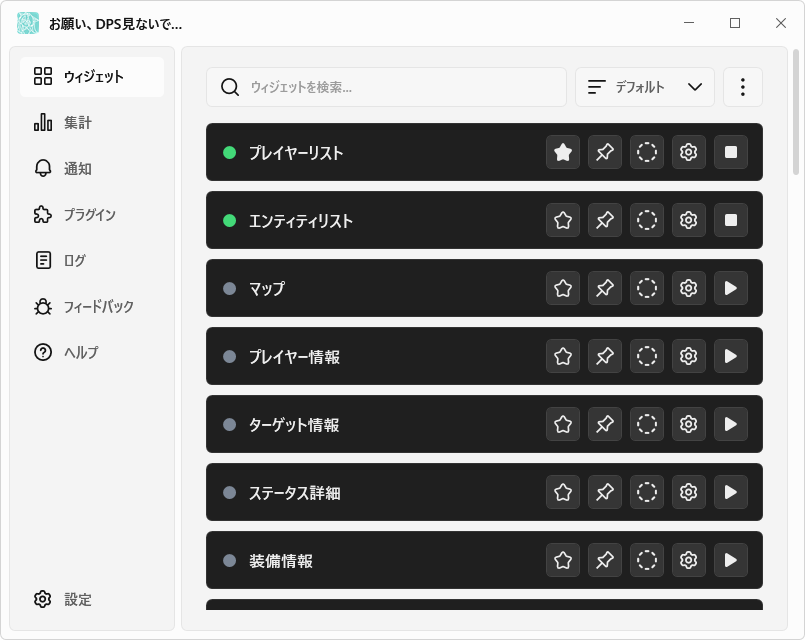

# お願い、DPS見ないで…

[日本語](https://github.com/kokoukohiro/StarResonanceDps) | [한국어](docs/README.ko.md) | [简体中文](docs/README.zh-CN.md) | [English](docs/README.en.md)

お願い、DPS見ないで…(StarResonanceDps)は、ゲーム『ブループロトコル：スターレゾナンス』の戦闘情報(DPSなど)を表示する非公式のツールです。

このアプリは、旧バージョン([anying1073/StarResonanceDps](https://github.com/anying1073/StarResonanceDps))をもとに開発を続けているものです。旧バージョンを共に開発し、このアプリの完成に必要な情報を提供した方々に感謝します。

## 🌟 主な機能

- DPS・HPS・被ダメージのリアルタイムの集計と、スキル別の内訳・推移グラフ
- 過去の戦闘の履歴と、時間を決めた計測
- 周りのプレイヤーと敵の一覧(HP・バフ・ヘイト・詠唱など)
- 装備・アビリティ・潜在心相晶・モジュールの表示
- 敵の行動と予兆技を時系列で並べるタイムライン
- 予兆技やHPの低下などの通知と読み上げ
- プラグインによる機能の拡張(モジュールの組み合わせを探すプラグインを同梱)
- 日本語・韓国語・簡体字中国語・英語に対応

## 🚀 クイックスタート

### 動作要件

- Windows(64ビット)
- [.NET 10デスクトップランタイム](https://dotnet.microsoft.com/download/dotnet/10.0)
- [Npcap](https://npcap.com/)

### インストール

1. [Releases](https://github.com/kokoukohiro/StarResonanceDps/releases)から`StarResonanceDps-<バージョン>.zip`をダウンロードします
2. zipを、書き込みできるフォルダに展開します
3. フォルダの中の`StarResonanceDps.exe`を起動します

- 設定と戦闘の履歴は、このフォルダの中に保存されます
- 初回の起動時に、Windowsの警告(SmartScreen)が表示されることがあります。「詳細情報」を押すと「実行」を選択できます
- ホットキーの補助プログラムを起動するときに、ユーザーアカウント制御の確認が表示されます。ホットキーを使わない場合は、全体設定の起動設定で「アプリ起動時にホットキー補助プログラムを起動」をオフにしてください
- 新しいバージョンがあると、起動時に確認のウィンドウが表示されます。「ヘルプ」の「更新を確認」でも確認できます。詳しくは[入れ方と更新](https://github.com/kokoukohiro/StarResonanceDps/wiki/入れ方と更新)を参照してください
- 起動した後の設定は、[最初の設定](https://github.com/kokoukohiro/StarResonanceDps/wiki/最初の設定)を参照してください

### 使い方

画面と設定の説明は[Wiki](https://github.com/kokoukohiro/StarResonanceDps/wiki/お願い、DPS見ないで…Wiki)、困ったときの対処法は[困ったとき](https://github.com/kokoukohiro/StarResonanceDps/wiki/困ったとき)を参照してください。

## 📷 スクリーンショット

### メイン画面(ウィジェット)

### ウィジェット(DPSメーター)

## 👥 不具合報告・機能要望

アプリの「フィードバック」から、GitHubのIssueへ投稿できます。[Issues](https://github.com/kokoukohiro/StarResonanceDps/issues)から直接投稿することもできます。投稿にはGitHubのアカウントが必要です。

## ⚙️ プラグイン開発

プラグインで機能を追加できます。作り方は[プラグイン開発](https://github.com/kokoukohiro/StarResonanceDps/wiki/プラグイン開発)を参照してください。SDKのパッケージ(`.nupkg`)は、Releasesにアプリのzipと並べて公開しています。

## ✅ 安全性・プライバシーについて

- ゲームのクライアントを改変しません
- 追加したプラグインを除くと、アプリが外部へ接続するのは次のときだけです。戦闘のデータは送信しません
  - 更新の確認とダウンロード(GitHub)
  - 「フィードバック」で報告済みかを確認するとき(GitHub)
  - 「プレイヤー情報」で顔と名刺の写真を表示するとき(ゲームから受信した写真のURL)
- プラグインはアプリの中で動作し、アプリと同じ操作ができます。信頼できる配布元のプラグインだけを追加してください

## ⭐ お願い

表示される数値は自分のプレイのために使い、ほかのプレイヤーへの誹謗中傷など、コミュニティの環境を損なう目的には使用しないでください。

## ❤ 開発の支援

[GitHub Sponsors](https://github.com/sponsors/kokoukohiro)から開発を支援できます。いただく支援は、開発の継続と、ゲームの更新への対応に大切に使います。

## 📄 ライセンス

- 本体はGNU GPL v3(追加の許可と追加の条件あり)、プラグインSDKとそのアナライザー、プラグインサンプル、ドキュメントはMITです。詳しくは[LICENSING.md](LICENSING.md)を参照してください
- 使用しているライブラリのライセンスは、[THIRD-PARTY-NOTICES.txt](THIRD-PARTY-NOTICES.txt)を参照してください

## ⚠️ 免責事項

- このアプリは非公式で、ゲームの開発・運営とは関係ありません。ゲームの名前・データ・画像の権利は、それぞれの権利者に帰属します
- このアプリは現状のまま提供され、いかなる保証もありません。使用によって生じた損害について、作者は責任を負いません
