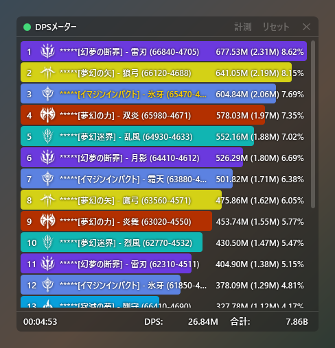

# お願い、DPS見ないで…

[日本語](https://github.com/kokoukohiro/StarResonanceDps) | [한국어](docs/README.ko.md) | [简体中文](docs/README.zh-CN.md) | [English](docs/README.en.md)

『ブループロトコル：スターレゾナンス』の戦闘情報(DPSなど)を表示する非公式のツールです(Windows用)。

戦闘の状況をリアルタイムで表示し、過去の戦闘の結果も振り返ることができます。戦闘中のできごとの通知や、機能の拡張にも対応しています。

ゲームのクライアントを改変せず、戦闘のデータを外部へ送信することもありません。表示される数値を、他のプレイヤーへの誹謗中傷など、コミュニティの環境を損なう目的で使用しないでください。

## 必要なもの

- Windows(64ビット)
- [.NET 10デスクトップランタイム](https://dotnet.microsoft.com/download/dotnet/10.0)
- [Npcap](https://npcap.com/)

## 入れ方

1. [リリース](https://github.com/kokoukohiro/StarResonanceDps/releases)から`StarResonanceDps-<バージョン>.zip`を取得します
2. zipを、書き込みのできるフォルダへ展開します
3. フォルダの中の`StarResonanceDps.exe`を起動します

- 設定と戦闘の履歴は、このフォルダの中に保存します
- 最初の起動で、Windowsの警告(SmartScreen)が出ることがあります。「詳細情報」を押すと「実行」を選べます
- ホットキーを使うための補助プログラムを起動するときに、ユーザーアカウント制御の確認が出ます。使わない場合は、全体設定の起動設定で「アプリ起動時にホットキー補助プログラムを起動」をオフにしてください
- 起動した後にすることは、[最初の設定](https://github.com/kokoukohiro/StarResonanceDps/wiki/最初の設定)にあります

## 更新

アプリの中から、新しいバージョンへ更新できます。新しいバージョンがあると、起動時に確認の窓が出ます。「ヘルプ」の「更新を確認」を押しても確かめられます。詳しくは[入れ方と更新](https://github.com/kokoukohiro/StarResonanceDps/wiki/入れ方と更新)にあります。

## 使い方

画面と設定の説明は、[Wiki](https://github.com/kokoukohiro/StarResonanceDps/wiki/お願い、DPS見ないで…Wiki)にあります。

## プラグイン

プラグインで機能を足せます。プラグインはアプリの中で動き、アプリと同じことができます。入れるのは信頼できる配布元のものだけにしてください。

作り方は[プラグイン開発](https://github.com/kokoukohiro/StarResonanceDps/wiki/プラグイン開発)にあります。SDKのパッケージ(`.nupkg`)は、リリースにアプリのzipと並んでいます。

## 不具合の報告と要望

アプリの「フィードバック」から、GitHubのIssueへ投稿できます。投稿にはGitHubのアカウントが必要です。

## 通信

入れたプラグインを除くと、アプリが外部へ接続するのは次のときだけです。戦闘のデータは送りません。

- 更新の確認とダウンロード(GitHub)
- 「フィードバック」で報告済みかを確かめるとき(GitHub)
- 「プレイヤー情報」で顔と名刺の写真を表示するとき(ゲームから届いた写真のURL)

## ライセンス

- 本体はGNU GPL v3(追加の許可あり)、SDK・解析器・サンプル・文書はMITです。詳しくは[LICENSING.md](LICENSING.md)にあります
- 使っているライブラリのライセンスは、[THIRD-PARTY-NOTICES.txt](THIRD-PARTY-NOTICES.txt)にあります
- このツールは非公式で、ゲームの開発・運営とは関係ありません。ゲームの名前・データ・画像の権利は、それぞれの権利者にあります
