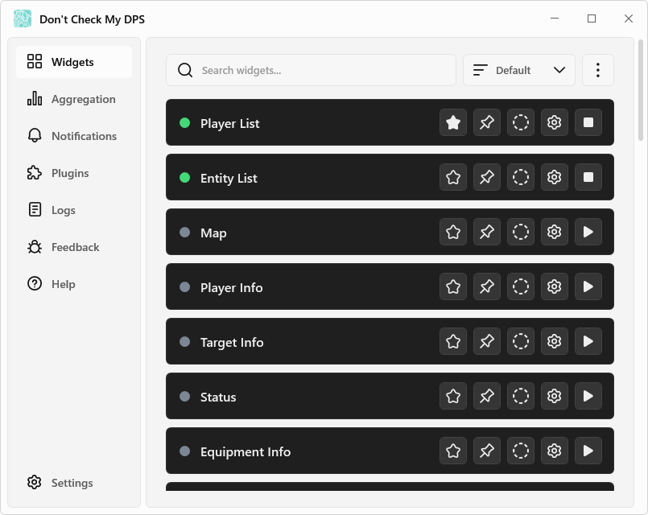
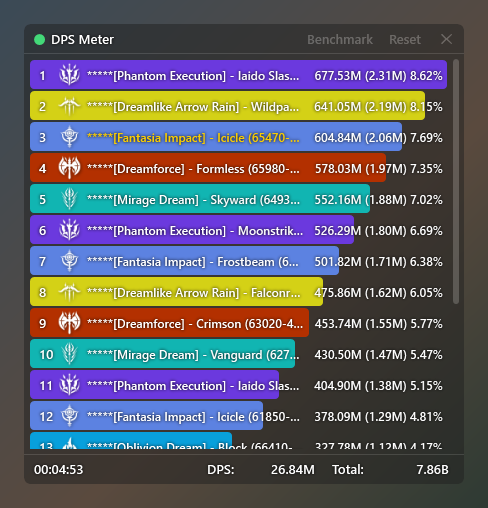

# Don't Check My DPS

[日本語](https://github.com/kokoukohiro/StarResonanceDps) | [한국어](README.ko.md) | [简体中文](README.zh-CN.md) | [English](README.en.md)

Don't Check My DPS (StarResonanceDps) is an unofficial tool that shows combat information (such as DPS) for the game Blue Protocol: Star Resonance.

This app is developed as a continuation of the earlier version ([anying1073/StarResonanceDps](https://github.com/anying1073/StarResonanceDps)). Thanks to the fellow developers of the earlier version for providing the information needed to complete this app.

## 🌟 Features

- Real-time DPS, HPS, and damage taken, with per-skill breakdowns and trend graphs
- History of past battles and timed benchmarks
- Lists of nearby players and enemies (HP, buffs, aggro, chanting, and more)
- Equipment, talents, Deep-Slumber Psychoscope, and modules
- A timeline of enemy actions and telegraphed skills in chronological order
- Notifications and read-aloud for telegraphed skills, low HP, and more
- Extensions through plugins (includes a plugin that finds module combinations)
- Available in Japanese, Korean, Simplified Chinese, and English

## 🚀 Quick start

### Requirements

- Windows (64-bit)
- [.NET 10 Desktop Runtime](https://dotnet.microsoft.com/download/dotnet/10.0)
- [Npcap](https://npcap.com/)

### Installation

1. Download `StarResonanceDps-<version>.zip` from [Releases](https://github.com/kokoukohiro/StarResonanceDps/releases).
2. Extract the zip to a folder you can write to.
3. Start `StarResonanceDps.exe` in the folder.

- Settings and combat history are saved in this folder.
- The first time you start the app, a Windows warning (SmartScreen) may appear. Clicking "More info" lets you select "Run anyway".
- A User Account Control prompt appears when the hotkey helper program starts. If you do not use hotkeys, turn off "Launch hotkey helper at app startup" in the "Startup" section of Settings.
- When a new version is available, a confirmation window appears at startup. You can also check by clicking "Check for updates" in "Help". For details, see [Installation and Updates](https://github.com/kokoukohiro/StarResonanceDps/wiki/Installation-and-Updates).
- For the settings after starting the app, see [Initial Setup](https://github.com/kokoukohiro/StarResonanceDps/wiki/Initial-Setup).

### Usage

The screens and settings are described in the [Wiki](https://github.com/kokoukohiro/StarResonanceDps/wiki/Don't-Check-My-DPS-Wiki), and solutions to common problems in [Troubleshooting](https://github.com/kokoukohiro/StarResonanceDps/wiki/Troubleshooting).

## 📷 Screenshots

### Main window (Widgets)

### Widget (DPS Meter)

## 👥 Bug reports and feature requests

You can post to GitHub Issues from "Feedback" in the app. You can also post directly from [Issues](https://github.com/kokoukohiro/StarResonanceDps/issues). Posting requires a GitHub account.

## ⚙️ Plugin development

You can add features with plugins. For how to make plugins, see [Plugin Development](https://github.com/kokoukohiro/StarResonanceDps/wiki/Plugin-Development). The SDK package (`.nupkg`) is published in Releases, alongside the app zip.

## ✅ Safety & Privacy

- The app does not modify the game client.
- Apart from plugins you add, the app connects to external servers only in the following cases. It does not send combat data.
  - Checking for and downloading updates (GitHub)
  - Checking in "Feedback" whether items have already been reported (GitHub)
  - Showing avatar and name card photos in "Player Info" (photo URLs received from the game)
- Plugins run inside the app and can do the same things as the app. Add only plugins from sources you trust.

## ⭐ A request

Use the displayed numbers for your own play, and do not use them to defame other players or otherwise harm the community.

## ❤ Sponsorship

You can support development through [GitHub Sponsors](https://github.com/sponsors/kokoukohiro). Any support received will be put to good use for continued development and for keeping up with game updates.

## 📄 License

- The app itself is licensed under the GNU GPL v3 (with additional permissions and additional terms), and the plugin SDK and its analyzers, the plugin samples, and the documentation are licensed under the MIT License. For details, see [LICENSING.md](../LICENSING.md).
- For the licenses of the libraries used, see [THIRD-PARTY-NOTICES.txt](../THIRD-PARTY-NOTICES.txt).

## ⚠️ Disclaimer

- This app is unofficial and is not affiliated with the game's developers or operators. The rights to the game's name, data, and images belong to their respective owners.
- This app is provided as is, without any warranty. The author is not responsible for any damage resulting from its use.
