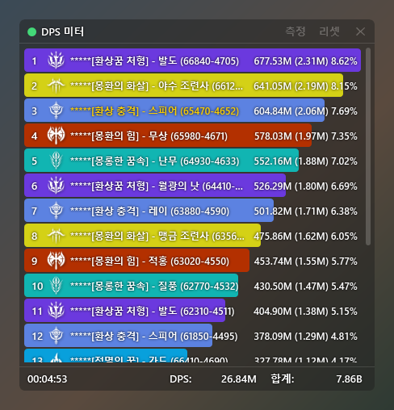

# 내 DPS 조회하지 마

[日本語](https://github.com/kokoukohiro/StarResonanceDps) | [한국어](README.ko.md) | [简体中文](README.zh-CN.md) | [English](README.en.md)

블루 프로토콜: 스타 레조넌스의 전투 정보(DPS 등)를 표시하는 비공식 도구입니다(Windows용).

전투 상황을 실시간으로 표시하고, 지난 전투의 결과도 돌아볼 수 있습니다. 전투 중 일어나는 일의 알림과 기능 확장도 지원합니다.

게임 클라이언트를 수정하지 않으며, 전투 데이터를 외부로 전송하지도 않습니다. 표시되는 수치를 다른 플레이어에 대한 비방 등 커뮤니티 환경을 해치는 목적으로 사용하지 마십시오.

## 필요 사항

- Windows(64비트)
- [.NET 10 데스크톱 런타임](https://dotnet.microsoft.com/download/dotnet/10.0)
- [Npcap](https://npcap.com/)

## 설치 방법

1. [릴리스](https://github.com/kokoukohiro/StarResonanceDps/releases)에서 `StarResonanceDps-<버전>.zip`을 받습니다.
2. zip을 쓰기 가능한 폴더에 압축 해제합니다.
3. 폴더 안의 `StarResonanceDps.exe`를 실행합니다.

- 설정과 전투 기록은 이 폴더 안에 저장됩니다.
- 처음 실행할 때 Windows 경고(SmartScreen)가 표시될 수 있습니다. '추가 정보'를 누르면 '실행'을 선택할 수 있습니다.
- 단축키를 사용하기 위한 보조 프로그램을 실행할 때 사용자 계정 컨트롤 확인 창이 표시됩니다. 사용하지 않는 경우에는 설정의 시작 설정에서 '앱 시작 시 단축키 보조 프로그램 실행'을 끄세요.
- 실행한 뒤 해야 할 일은 [초기 설정](https://github.com/kokoukohiro/StarResonanceDps/wiki/초기-설정)에 있습니다.

## 업데이트

앱 안에서 새 버전으로 업데이트할 수 있습니다. 새 버전이 있으면 실행할 때 확인 창이 표시됩니다. '도움말'의 '업데이트 확인'을 눌러도 확인할 수 있습니다. 자세한 내용은 [설치와 업데이트](https://github.com/kokoukohiro/StarResonanceDps/wiki/설치와-업데이트)에 있습니다.

## 사용 방법

화면과 설정 설명은 [Wiki](https://github.com/kokoukohiro/StarResonanceDps/wiki/내-DPS-조회하지-마-Wiki)에 있습니다.

## 플러그인

플러그인으로 기능을 추가할 수 있습니다. 플러그인은 앱 안에서 작동하며, 앱과 같은 일을 할 수 있습니다. 신뢰할 수 있는 배포처의 플러그인만 설치하세요.

만드는 방법은 [플러그인 개발](https://github.com/kokoukohiro/StarResonanceDps/wiki/플러그인-개발)에 있습니다. SDK 패키지(`.nupkg`)는 릴리스에 앱의 zip과 함께 올라와 있습니다.

## 버그 제보와 요청

앱의 '피드백'에서 GitHub Issue를 작성할 수 있습니다. 작성하려면 GitHub 계정이 필요합니다.

## 통신

설치한 플러그인을 제외하면, 앱이 외부에 연결하는 것은 다음의 경우뿐입니다. 전투 데이터는 보내지 않습니다.

- 업데이트 확인과 다운로드(GitHub)
- '피드백'에서 제보 여부를 확인할 때(GitHub)
- '플레이어 정보'에서 얼굴과 명함 사진을 표시할 때(게임에서 받은 사진의 URL)

## 라이선스

- 본체는 GNU GPL v3(추가 허가 포함)이며, SDK·분석기·샘플·문서는 MIT입니다. 자세한 내용은 [LICENSING.md](../LICENSING.md)에 있습니다.
- 사용하는 라이브러리의 라이선스는 [THIRD-PARTY-NOTICES.txt](../THIRD-PARTY-NOTICES.txt)에 있습니다.
- 이 도구는 비공식이며, 게임의 개발·운영과는 관계가 없습니다. 게임의 이름·데이터·이미지에 대한 권리는 각 권리자에게 있습니다.
