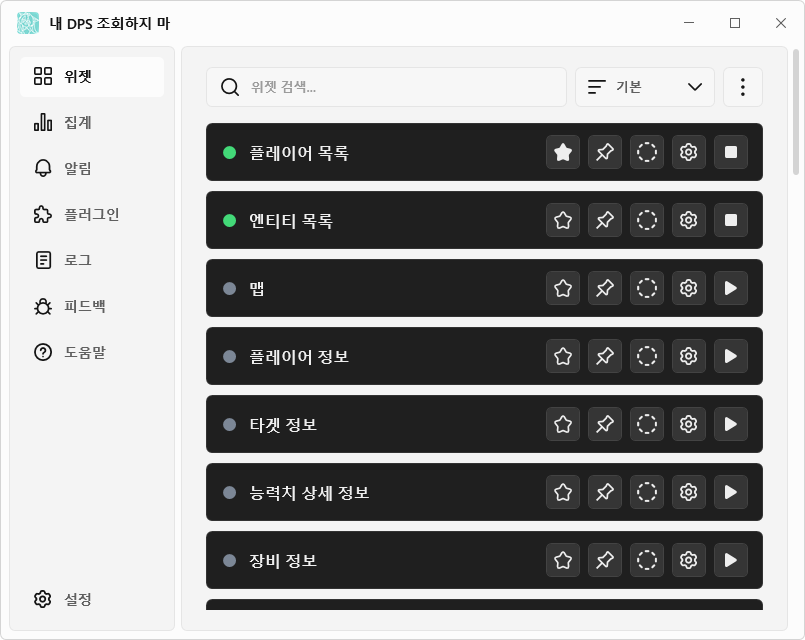

# 내 DPS 조회하지 마

[日本語](https://github.com/kokoukohiro/StarResonanceDps) | [한국어](README.ko.md) | [简体中文](README.zh-CN.md) | [English](README.en.md)

내 DPS 조회하지 마(StarResonanceDps)는 게임 블루 프로토콜: 스타 레조넌스의 전투 정보(DPS 등)를 표시하는 비공식 도구입니다.

이 앱은 이전 버전([anying1073/StarResonanceDps](https://github.com/anying1073/StarResonanceDps))을 바탕으로 개발을 이어 가고 있습니다. 이 앱의 완성에 필요한 정보를 제공해 주신, 이전 버전을 함께 개발한 모든 분께 감사드립니다.

## 🌟 주요 기능

- DPS·HPS·받은 피해의 실시간 집계와 스킬별 내역·추이 그래프
- 지난 전투의 기록과 시간을 정한 측정
- 주위의 플레이어와 적의 목록(HP·버프·적대 수치·캐스팅 등)
- 장비·어빌리티·깊은 잠 심상의·모듈 표시
- 적의 행동과 예고 스킬을 시간순으로 나열하는 타임라인
- 예고 스킬, HP 저하 등의 알림과 음성 읽기
- 플러그인을 통한 기능 확장(모듈 조합을 찾는 플러그인 기본 제공)
- 일본어·한국어·중국어(간체)·영어 지원

## 🚀 빠른 시작

### 실행 환경

- Windows(64비트)
- [.NET 10 데스크톱 런타임](https://dotnet.microsoft.com/download/dotnet/10.0)
- [Npcap](https://npcap.com/)

### 설치

1. [Releases](https://github.com/kokoukohiro/StarResonanceDps/releases)에서 `StarResonanceDps-<버전>.zip`을 다운로드합니다.
2. zip을 쓰기 가능한 폴더에 압축 해제합니다.
3. 폴더 안의 `StarResonanceDps.exe`를 실행합니다.

- 설정과 전투 기록은 이 폴더 안에 저장됩니다.
- 처음 실행할 때 Windows 경고(SmartScreen)가 표시될 수 있습니다. '추가 정보'를 누르면 '실행'을 선택할 수 있습니다.
- 단축키 보조 프로그램을 실행할 때 사용자 계정 컨트롤 확인 창이 표시됩니다. 단축키를 사용하지 않는 경우에는 설정의 시작 설정에서 '앱 시작 시 단축키 보조 프로그램 실행'을 끄세요.
- 새 버전이 있으면 실행할 때 확인 창이 표시됩니다. '도움말'의 '업데이트 확인'으로도 확인할 수 있습니다. 자세한 내용은 [설치와 업데이트](https://github.com/kokoukohiro/StarResonanceDps/wiki/설치와-업데이트)를 참조하세요.
- 실행한 뒤의 설정은 [초기 설정](https://github.com/kokoukohiro/StarResonanceDps/wiki/초기-설정)을 참조하세요.

### 사용 방법

화면과 설정 설명은 [Wiki](https://github.com/kokoukohiro/StarResonanceDps/wiki/내-DPS-조회하지-마-Wiki), 문제가 생겼을 때의 해결 방법은 [문제 해결](https://github.com/kokoukohiro/StarResonanceDps/wiki/문제-해결)을 참조하세요.

## 📷 스크린샷

### 메인 화면(위젯)

### 위젯(DPS 미터)

## 👥 버그 제보와 기능 요청

앱의 '피드백'에서 GitHub Issue를 작성할 수 있습니다. [Issues](https://github.com/kokoukohiro/StarResonanceDps/issues)에서 직접 작성할 수도 있습니다. 작성하려면 GitHub 계정이 필요합니다.

## ⚙️ 플러그인 개발

플러그인으로 기능을 추가할 수 있습니다. 만드는 방법은 [플러그인 개발](https://github.com/kokoukohiro/StarResonanceDps/wiki/플러그인-개발)을 참조하세요. SDK 패키지(`.nupkg`)는 Releases에 앱의 zip과 함께 공개되어 있습니다.

## ✅ 안전성과 개인 정보

- 게임 클라이언트를 수정하지 않습니다.
- 추가한 플러그인을 제외하면, 앱이 외부에 연결하는 것은 다음의 경우뿐입니다. 전투 데이터는 전송하지 않습니다.
  - 업데이트 확인과 다운로드(GitHub)
  - '피드백'에서 제보 여부를 확인할 때(GitHub)
  - '플레이어 정보'에서 얼굴과 명함 사진을 표시할 때(게임에서 받은 사진의 URL)
- 플러그인은 앱 안에서 작동하며, 앱과 같은 작업을 할 수 있습니다. 신뢰할 수 있는 배포처의 플러그인만 추가하세요.

## ⭐ 부탁

표시되는 수치는 자신의 플레이를 위해 사용하고, 다른 플레이어에 대한 비방 등 커뮤니티 환경을 해치는 목적으로는 사용하지 마십시오.

## ❤ 개발 후원

[GitHub Sponsors](https://github.com/sponsors/kokoukohiro)에서 개발을 후원할 수 있습니다. 보내 주신 후원은 개발을 이어 가고 게임 업데이트에 대응하는 데 소중히 사용하겠습니다.

## 📄 라이선스

- 본체는 GNU GPL v3(추가 허가와 추가 조건 포함)이며, 플러그인 SDK와 그 분석기, 플러그인 샘플, 문서는 MIT입니다. 자세한 내용은 [LICENSING.md](../LICENSING.md)를 참조하세요.
- 사용하는 라이브러리의 라이선스는 [THIRD-PARTY-NOTICES.txt](../THIRD-PARTY-NOTICES.txt)를 참조하세요.

## ⚠️ 면책 조항

- 이 앱은 비공식이며, 게임의 개발·운영과는 관계가 없습니다. 게임의 이름·데이터·이미지에 대한 권리는 각 권리자에게 있습니다.
- 이 앱은 있는 그대로 제공되며, 어떠한 보증도 하지 않습니다. 사용으로 인해 생긴 손해에 대해 작성자는 책임을 지지 않습니다.
