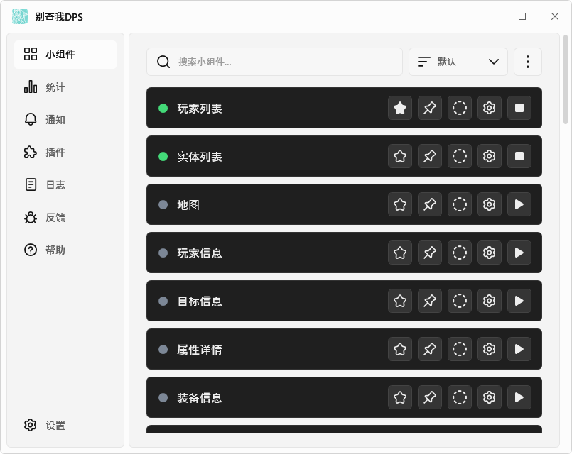
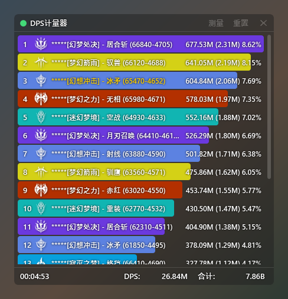

# 别查我DPS

[日本語](https://github.com/kokoukohiro/StarResonanceDps) | [한국어](README.ko.md) | [简体中文](README.zh-CN.md) | [English](README.en.md)

别查我DPS(StarResonanceDps)是显示游戏《星痕共鸣》战斗信息(DPS等)的非官方工具。

本应用是在旧版本([anying1073/StarResonanceDps](https://github.com/anying1073/StarResonanceDps))的基础上继续开发的。感谢一同开发旧版本、为本应用的完成提供所需资料的各位。

## 🌟 功能特性

- DPS、HPS、承伤的实时统计，以及按技能细分和趋势图表
- 以往战斗的历史记录和限定时间的测量
- 附近玩家和敌人的列表(HP、增益、仇恨、吟唱等)
- 装备、天赋、深眠心相仪、模组的显示
- 按时间顺序排列敌人行动和预兆技能的时间轴
- 预兆技能、HP降低等的通知和朗读
- 通过插件扩展功能(内置寻找模组组合的插件)
- 支持日语、韩语、简体中文、英语

## 🚀 快速开始

### 运行环境

- Windows(64位)
- [.NET 10桌面运行时](https://dotnet.microsoft.com/download/dotnet/10.0)
- [Npcap](https://npcap.com/)

### 安装

1. 从[Releases](https://github.com/kokoukohiro/StarResonanceDps/releases)下载`StarResonanceDps-<版本>.zip`
2. 将zip解压到可写入的文件夹
3. 启动文件夹中的`StarResonanceDps.exe`

- 设置和战斗历史记录会保存在此文件夹中
- 首次启动时，可能会出现Windows的警告(SmartScreen)。点击“更多信息”后即可选择“仍要运行”
- 启动快捷键辅助程序时，会出现用户帐户控制的确认提示。如不使用快捷键，请在设置的启动设置中关闭“应用启动时运行快捷键辅助程序”
- 有新版本时，启动时会出现确认窗口。也可以通过“帮助”中的“检查更新”进行确认。详情请参阅[安装与更新](https://github.com/kokoukohiro/StarResonanceDps/wiki/安装与更新)
- 启动后的设置请参阅[初始设置](https://github.com/kokoukohiro/StarResonanceDps/wiki/初始设置)

### 使用方法

界面和设置的说明请参阅[Wiki](https://github.com/kokoukohiro/StarResonanceDps/wiki/别查我DPS-Wiki)，遇到问题时的解决方法请参阅[疑难解答](https://github.com/kokoukohiro/StarResonanceDps/wiki/疑难解答)。

## 📷 截图

### 主界面(小组件)

### 小组件(DPS计量器)

## 👥 问题反馈与功能建议

可以通过应用中的“反馈”向GitHub的Issue提交。也可以直接在[Issues](https://github.com/kokoukohiro/StarResonanceDps/issues)中提交。提交需要GitHub账号。

## ⚙️ 插件开发

可以通过插件添加功能。开发方法请参阅[插件开发](https://github.com/kokoukohiro/StarResonanceDps/wiki/插件开发)。SDK包(`.nupkg`)与应用的zip一起发布在Releases中。

## ✅ 安全与隐私

- 不修改游戏客户端
- 除已添加的插件外，应用仅在以下情况下连接外部。不会发送战斗数据
  - 检查更新和下载(GitHub)
  - 在“反馈”中确认是否已反馈时(GitHub)
  - 在“玩家信息”中显示头像和名片照片时(从游戏接收的照片URL)
- 插件在应用中运行，可以进行与应用相同的操作。请只添加来自可信发布来源的插件

## ⭐ 一点请求

请将显示的数值用于自己的游戏，切勿用于诽谤中伤其他玩家等破坏社区环境的目的。

## ❤ 支持开发

可以通过[GitHub Sponsors](https://github.com/sponsors/kokoukohiro)支持开发。收到的每一份支持，都将用于持续开发和适配游戏更新。

## 📄 许可证

- 本体采用GNU GPL v3(含附加许可和附加条款)，插件SDK及其分析器、插件示例和文档采用MIT。详情请参阅[LICENSING.md](../LICENSING.md)
- 所用库的许可证请参阅[THIRD-PARTY-NOTICES.txt](../THIRD-PARTY-NOTICES.txt)

## ⚠️ 免责声明

- 本应用为非官方应用，与游戏的开发和运营方无关。游戏名称、数据和图片的权利归各自的权利人所有
- 本应用按现状提供，不作任何保证。对于因使用本应用而产生的任何损失，作者不承担责任
